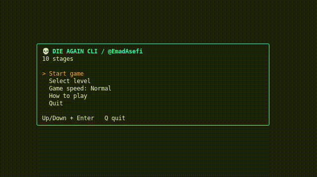

# 💀 DIE AGAIN CLI

A rage-inducing terminal precision platformer inspired by Die Again and Level Devil. Dodge unpredictable traps, survive fake platforms, and expect to die… again and again!

A challenging and addictive Terminal User Interface (TUI) precision platformer built with **Go**, utilizing the popular **Bubble Tea** and **Lip Gloss** libraries.

> The objective is simple: dodge deadly traps, avoid false grounds, and make your way to the exit (`E`)!
<p align="center">
  
</p>

---

## 📑 Table of Contents
- [Features](#-features)
- [Game Legend](#-game-legend)
- [Controls](#-controls)
- [Installation](#-installation)
- [How to Run](#-how-to-run)
- [Custom Levels](#-custom-levels)
- [License](#-license)

---

## ✨ Features

- 🕹️ **Lightweight & Smooth:** Runs natively right inside your terminal.
- 🎯 **Adjustable Game Speed:** Choose between **Slow**, **Normal**, and **Fast** speeds directly from the main menu.
- 🗺️ **10 Handcrafted Puzzle Stages:** Jump straight into any stage using the level selector.
- 💀 **Death Counter:** Tracks how many times you've failed to challenge your friends.
- 🎨 **Modern TUI Styling:** Clean retro borders and vibrant ANSI colors powered by **Lip Gloss**.

---

## 🗺️ Game Legend

| Tile | Name | Description |
| :---: | :--- | :--- |
| `@` | **Player** | Your character |
| `E` | **Exit** | The goal to clear the stage |
| `#` | **Wall / Ground** | Safe platforms to walk and jump on |
| `^` | **Spike** | Instant death upon touch |
| `?` | **Decoy Trap** | Fake ground that kills you if stepped on |
| `!` & `=` | **Hidden Hazards** | Converted into spikes (`^`) upon loading |

---

## 🎮 Controls

### In-Game:
| Action | Keys |
| :--- | :--- |
| **Move Left / Right** | `A` / `D` or Arrow Keys (`←` / `→`) |
| **Jump** | `Space`, `W`, or Arrow Key (`↑`) |
| **Restart Stage** | `R` |
| **Next / Previous Stage** | `N` / `P` |
| **Return to Menu** | `Q` or `Esc` |

### In Menus:
| Action | Keys |
| :--- | :--- |
| **Navigate Options** | Arrow Keys (`↑` / `↓`) or `W` / `S` |
| **Select / Confirm** | `Enter` or `Space` |
| **Quit Game** | `Q` or `Ctrl+C` |

---

## 📦 Installation

Make sure you have **Go** (version 1.20 or higher) installed on your system.

1. Clone the repository:
```bash
git clone https://github.com/emadasefi/die-again-cli.git
cd die-again-cli
```

2. Download dependencies:

go mod tidy
```
## 🚀 How to Run

Ensure the level map file (`levels.txt`) is placed in the same directory as the source code or binary executable.

### Run Directly:
```bash
go run main.go
```

### Build Binary:
```bash
# Build the executable
go build -o die-again main.go

# Run on Linux / macOS
./die-again

# Run on Windows
.\die-again.exe
```

> **Tip:** For the best visual experience, make sure your terminal window size is at least `80x24` characters.

---

## 🛠️ Custom Levels

The game reads maps from `levels.txt`. It expects exactly **10 stages**. 

Format of a stage inside `levels.txt`:
```text
; Stage 01 - Stage Title
[ASCII map rows]
  @                        E
############################
---
```
- Each stage starts with `;` followed by the stage title.
- Stages are separated by `---`.
- Each stage must contain exactly **one `@`** and **at least one `E`**.

---

## 📄 License

This project is open-source and available under the [MIT License](LICENSE).

---

## — Feedback ❤️—

If you enjoyed this game, found it useful, or faced any issues, please give it a **star ⭐** on GitHub! 
Please leave a comment if you have any comments, suggestions or problems.
